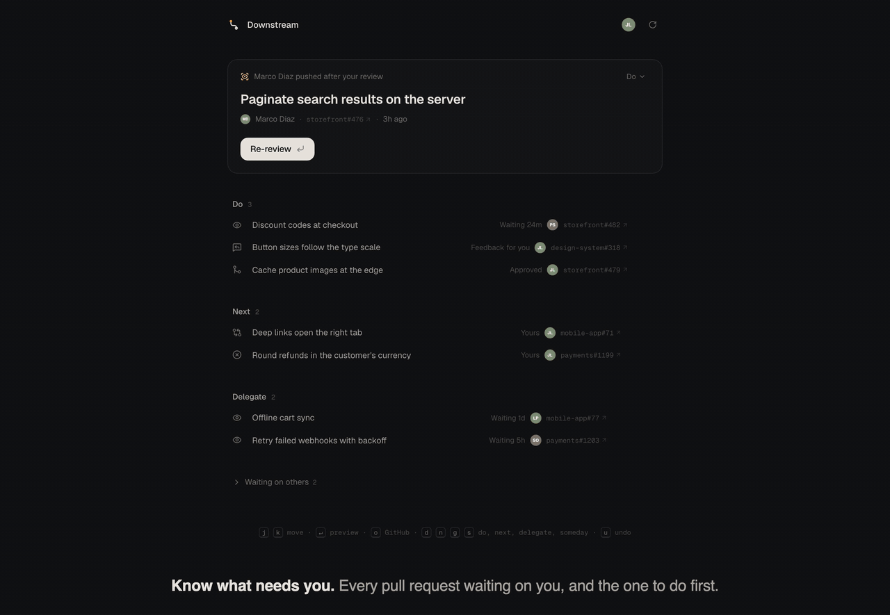
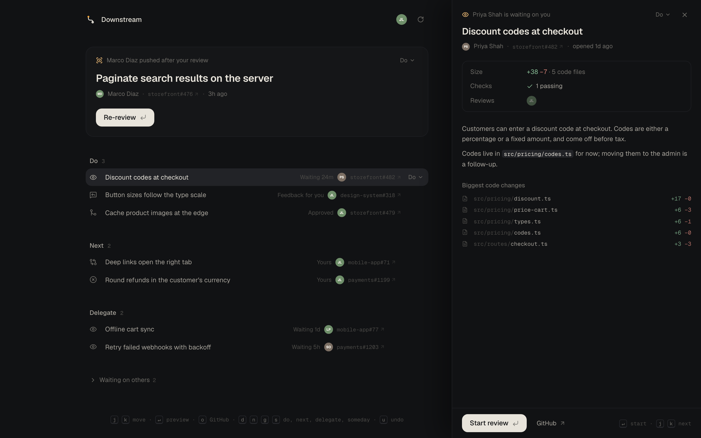
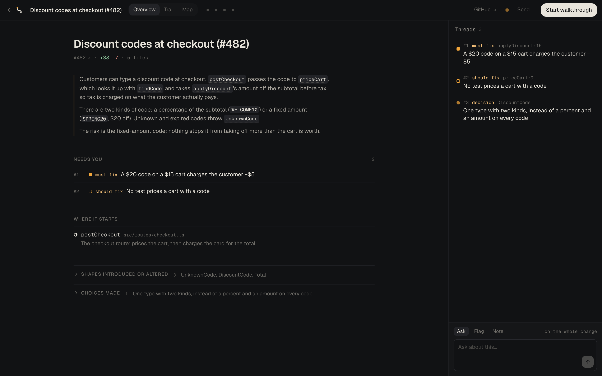
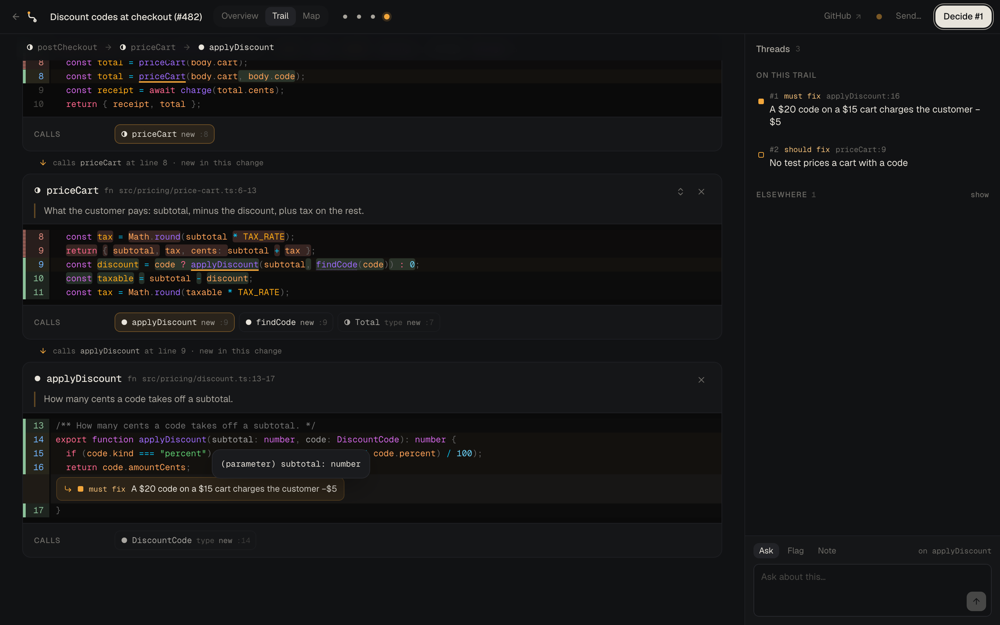
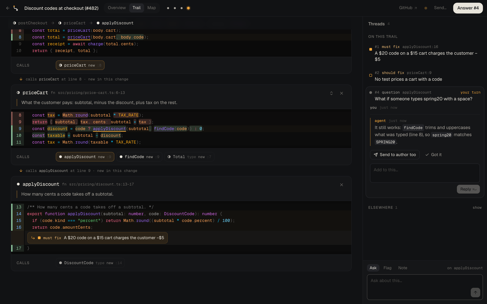
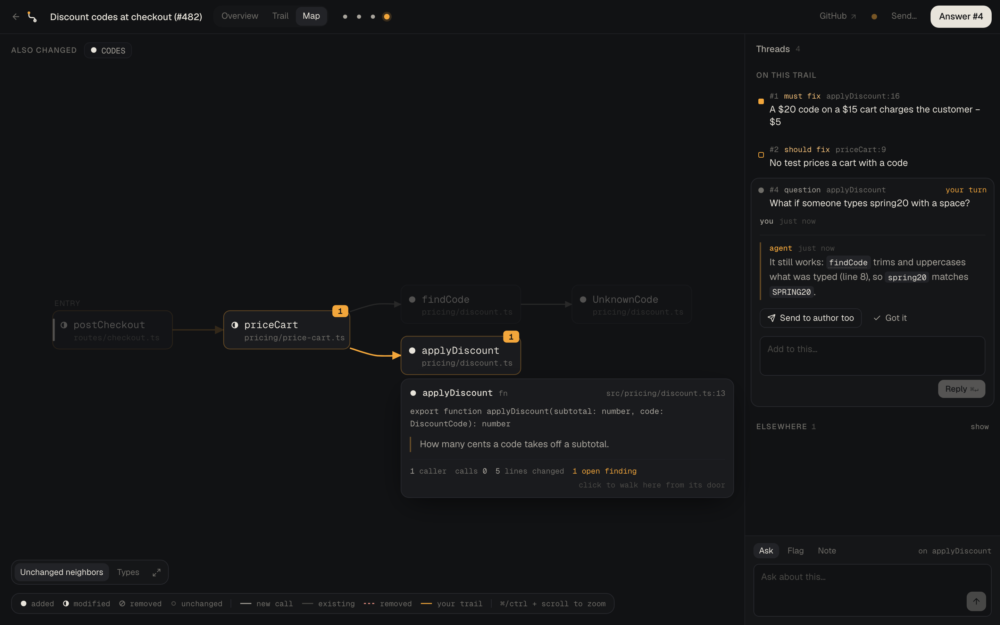
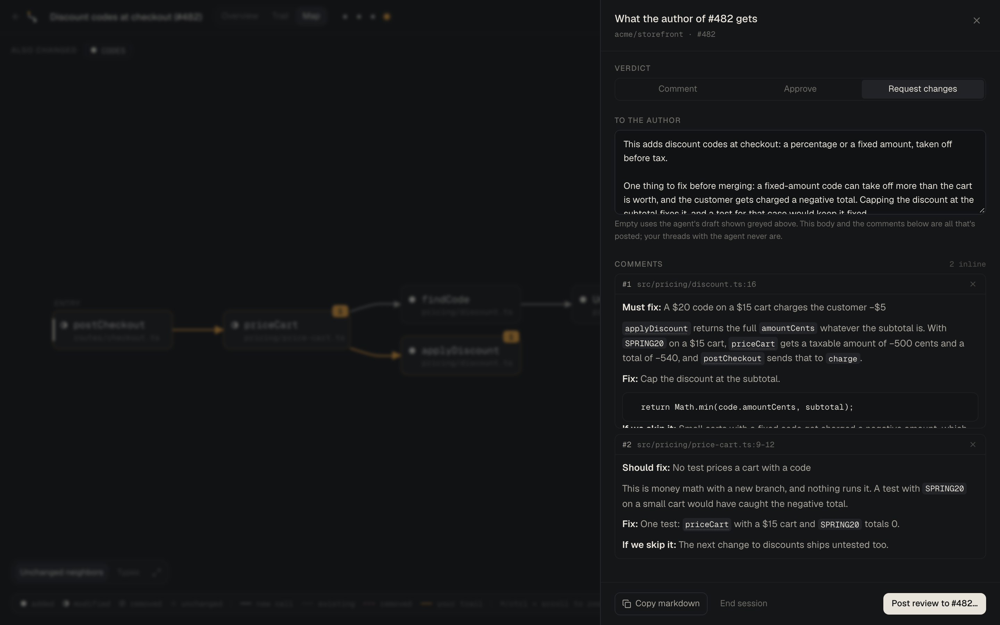

# Downstream

Get through the pull requests waiting on you, and understand every one you approve. Claude Code reads alongside you.

Pull requests pile up across repositories, a diff lists files alphabetically, and whatever your agent figured out about a change scrolls away with the chat. Downstream gives you one page of what needs you, opens each change at the place it starts, and keeps your agent next to the code while you read. You agree on a review together, and the review goes to the pull request in your words.



```bash
npx @armanckeser/downstream
```

You need Node 22.18 or newer, git, and the GitHub CLI signed in (`gh auth login`). The agent is Claude Code, running with your own settings.

## Know what needs you



Every open pull request that needs you sits on one page, sorted by how much it matters right now. **Do** holds what's blocking someone you work with, feedback on your own pull requests, and anything ready to merge. **Next** holds your own work that can wait. **Delegate** holds review requests from people outside what you're working on right now. Pull requests waiting on someone else fold away, and a pull request comes back to **Do** the moment its author pushes or replies after your review.

Each row says the one thing to do: *Review*, *Re-review*, *Merge*, *Address 3 threads*, *Fix checks*, *Resolve conflicts*. Press it and Claude Code starts on that pull request inside Downstream. It reads without asking, asks you in the browser before anything reaches other people, and leaves sending to you. **Move to terminal** hands the session to `claude --resume`.

Keys: `j`/`k` move, `↵` preview and start, `d` `n` `g` `s` move a row to Do, Next, Delegate or Someday, `u` undo, `o` open on GitHub, `r` refresh. With more than one GitHub account signed in to `gh`, you look through one at a time and the inboxes never mix.

## Understand each change



The agent reads the change first and leaves you a summary, the findings that need you, and the entry points: the route, the command, or the component where control comes in. Nothing else in the change calls an entry point, so that's where you start.



Start the walkthrough and each step opens the code that runs next, numbered like the real file, below the call that led to it. Findings sit on the lines they're about, with the concrete case that breaks and the smallest fix. Hover anything for its real TypeScript type and docs. `↵` always presses the next thing to do: the next step, an answer the agent is waiting on, or Send.

## Ask without losing your place



Select lines, or just ask about what's on screen. The agent already knows what you're looking at, answers in the margin, and can move your view to what it means. You keep reading while it works.

## See the whole change



The map lays the change out left to right from its entry points: what's new, what changed, which calls are new, and which existing code reaches in. Hover a piece for its callers, its calls and its open findings.

## Send what you agreed on



Send review shows exactly what the author will get: your verdict, a short note, and each finding as an inline comment, with a suggestion they can apply in one click when the fix is concrete. Each thread decides whether it reaches the author and in what words. Your conversation with the agent stays private, and nothing is posted until you confirm.

## Why

A diff is a list of files, top to bottom, alphabetically. Nobody understands code that way. You find where control comes in, follow what it calls, and stop wherever something looks odd to ask why it's like that. The diff never tells you the entry point, never shows who calls the function you're reading, and never says why the author chose this interface over the obvious other one. That lives in the author's head, or now in the agent's context, and it's gone when the pull request merges. Downstream keeps it next to the code while you decide.

## How it works with an agent

Downstream is a [Claude Code skill](SKILL.md). The agent drives a small CLI; you use the browser. Both go through the same actions on the same review, so either side can do anything the other can.

```bash
downstream open --pr 42          # analyze the change, open the browser
downstream show                  # the agent reads the map: doors, symbols, edges
downstream code pickNow          # and the code, numbered, with +/- marks and callers
downstream apply plan.json       # it writes the walkthrough: summary, steps, why, decisions, findings
downstream wait                  # then listens; returns when you ask, reply, resolve or finish
downstream reply 2 "…"           # and answers in the margin
downstream go openFirst          # or moves your view to what it's talking about
downstream outgoing 2 "…"        # words a finding for the author (or --exclude keeps it private)
downstream draft                 # the review exactly as it would be sent; you press Send
```

`downstream open --teach src/sync` does the same for existing code: no diff, a tour of how one request moves through that part of the system.

The analyzer does the mechanical part. It diffs the change against the merge base, finds every function, method, class, type, component and route that changed (JSDoc included), and resolves calls, renders and type uses through the TypeScript compiler. It finds unchanged callers, and works out which calls are new in the change and which disappeared. The agent does the part only a reader can: what each piece is for, the order to read it in, why it's shaped this way, and what's wrong with it.

## Built on agent-first primitives

Downstream follows the [agent-first-apps](https://github.com/armanckeser/agent-first-apps) contract, adapted to a tool that starts in a second inside any repository:

- **One source of truth.** A SQLite database per repository (`.downstream/review.db`, kept out of git), and one for the home page (`~/.downstream/home.db`: Now, pins, which repository and agent session belong to which pull request). The agent can query it read-only with `downstream sql`, and that connection cannot write.
- **One action surface.** Every change is an action defined once in `server/actions.ts` with a schema: `note.add`, `note.reply`, `steps.set`, `symbol.annotate`, `navigate`, …. The browser, the CLI and plain HTTP all call it. `downstream actions` lists them.
- **Live sync.** Every action emits an event. The browser follows them over server-sent events and updates as the agent writes.
- **Shared application state.** The browser reports what you're looking at (the view, the trail of open frames, your selected lines), so when you ask about "this" the agent already knows what this is (`downstream screen`). The agent can move your view with `navigate`.
- **Presence.** While `downstream wait` is blocked on you, the UI shows the agent as listening.

Postgres and Electric would be the agent-first default. A review is short-lived, local and per repository, though, so an embedded database and SSE keep the same guarantees with nothing to start.

## Install as a Claude Code skill

`npx` gives you the home page and the agent sessions it starts. To also start reviews from Claude Code itself (*"help me review this branch"*, *"review PR 42 with me"*, *"teach me how the sync engine works"*), install Downstream as a skill:

```bash
git clone https://github.com/armanckeser/downstream ~/.claude/skills/downstream
cd ~/.claude/skills/downstream && npm install && npm run build
node ~/.claude/skills/downstream/bin/downstream.mjs    # the home page, from any directory
```

One server runs per machine (`~/.downstream/`). Press a pull request and Downstream finds your clone of that repository under `~/projects`, `~/code`, `~/src`, `~/dev` or `~` (set `DOWNSTREAM_REPO_ROOTS` to search elsewhere), and makes a partial clone in `~/.downstream/repos/` when you don't have one. The first `open` in a repository takes a few seconds while TypeScript loads the project; after that the hovers are instant.

**Languages.** TypeScript and JavaScript go through the compiler: symbols, call resolution, callers, real types on hover. Python is read from indentation and imports: functions, classes and methods with decorators and docstrings, FastAPI/Flask routes as doors, calls through imports and `self`, callers across the repo, signatures and docstrings on hover. Tests in either are marked as tests. Other languages arrive as one symbol per changed file; the agent splits them into real functions and draws the edges (`addSymbols`, `edges` in `apply`).

## Development

```bash
npm install
npm run build          # the web UI, served by the local server
npm test               # analyzer tests against throwaway git repos
npm run typecheck
DOWNSTREAM_API=http://127.0.0.1:4317 npm run dev:web   # UI with hot reload against a running review
npm pack               # what npm would publish: the UI and dist/ (the CLI and server compiled to JS)
node scripts/film/stills.mjs                         # the README stills
FILM_MJS=<film.mjs> node scripts/film/shoot.mjs      # the launch GIF (needs a frame-stepped renderer)
```

A clone runs the TypeScript sources with Node's type stripping. A published copy lives under `node_modules`, where Node won't strip types, so `npm pack` and `npm publish` compile `cli/`, `server/` and `domain/` into `dist/` first (`server/install.ts` picks which one runs).

| Path | What lives there |
|---|---|
| `SKILL.md` | The agent's instructions: the loop, what a good walkthrough contains, how to talk in the margin |
| `domain/model.ts` | The review model, shared by server, CLI and browser |
| `server/analyze/` | Git sides, TypeScript declarations, the flow graph |
| `server/actions.ts` | Every action, defined once |
| `server/publish.ts` | The review as the PR author sees it, and sending it |
| `server/analyze/py.ts` | Python declarations, imports and calls |
| `server/main.ts` | HTTP, SSE, `wait`; one server for every repository (`/r/<repo>/api`) |
| `domain/inbox.ts` | The next action for each pull request, stacks, and the Do / Next / Delegate / Someday sort |
| `domain/next-move.ts` | The one next thing to do inside a review |
| `domain/approval.ts` | Which agent tool calls run without asking |
| `server/github.ts`, `server/gh.ts` | The inbox from GitHub search, per account |
| `server/agent-host.ts`, `server/home.ts` | Agent sessions started from the home page; the home API |
| `cli/downstream.ts` | The agent's CLI |
| `web/src/` | The review surface (React, Tailwind, [Pierre diffs](https://diffs.com) and [trees](https://www.npmjs.com/package/@pierre/trees), dagre) |
| `server/install.ts` | Where Downstream's files live, in a clone or a published copy |
| `scripts/film/` | The README's GIF and stills, against a made-up inbox (a stand-in `gh`) and a made-up storefront repository |

## License

[MIT](LICENSE)
